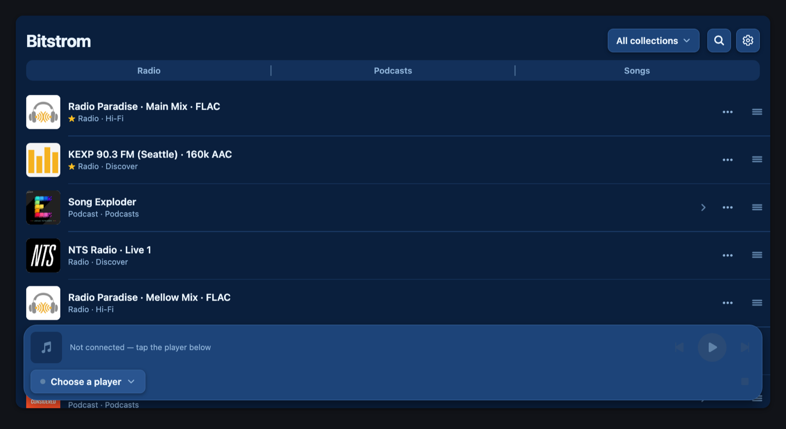
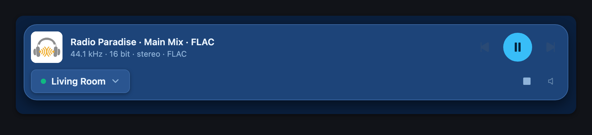

# Bitstrom card

[](https://hacs.xyz)
[](https://github.com/yybd/bitstrom-card/actions/workflows/validate.yml)

Bitstrom on your Home Assistant dashboard: your internet radio, podcasts and
music library, and the player bar for the players in your home — MPD (moOde,
Volumio…), LMS / Squeezelite, DLNA renderers, Sonos, BluOS, WiiM / LinkPlay,
HEOS, Chromecast and Home Assistant media players. Music plays **bit-perfect**:
each player gets it exactly as it is, never converted.

The card shows the whole Bitstrom app, or just the player bar, from the
[Bitstrom add-on](https://github.com/yybd/bitstrom-ha-addon) or any Bitstrom
server on your network (the desktop app, the Docker image).

- **Finds the add-on by itself.** No address to type: the card opens the
  add-on through Home Assistant, so it works over **https and Nabu Casa**
  too, away from home, behind Home Assistant's sign-in.
- **The player bar alone** (`mode: player`): what plays, play / next /
  previous, the player and the volume, in one slim card.
- **Opens where you want:** on radio, podcasts or songs, and on one
  collection — several focused cards on one dashboard.





## What you need

A running Bitstrom server. On Home Assistant OS or Supervised, install the
add-on:

[](https://my.home-assistant.io/redirect/supervisor_add_addon_repository/?repository_url=https%3A%2F%2Fgithub.com%2Fyybd%2Fbitstrom-ha-addon)

The card finds the add-on by itself (add-on 1.0.0 or later). On Home
Assistant Container or Core, run the Bitstrom desktop app or Docker image on
any machine on the network, and give the card its address.

## Install

### HACS

[](https://my.home-assistant.io/redirect/hacs_repository/?owner=yybd&repository=bitstrom-card&category=plugin)

1. In HACS, search for **Bitstrom card** and open it (or use the button above).
2. Press **Download**, then reload the browser.
3. Edit a dashboard → **Add card** → **Bitstrom**.

### Manual

1. Copy `bitstrom-card.js` into `<config>/www/`.
2. **Settings → Dashboards → ⋮ → Resources → Add resource**:
   `/local/bitstrom-card.js`, type **JavaScript module**.
3. Reload the browser and add the card as above.

## Options

Everything can be set in the card's visual editor.

```yaml
type: custom:bitstrom-card
mode: full            # full: the Bitstrom app; player: the player bar alone
view: radio           # optional: radio, podcasts or songs
collection: Jazz      # optional: a collection's name
height: 640           # pixels
title: Bitstrom       # optional
```

The player bar alone:

```yaml
type: custom:bitstrom-card
mode: player
```

| Option | Default | |
| --- | --- | --- |
| `mode` | `full` | `full`: the whole app. `player`: the player bar alone. |
| `view` | everything | `full` only: open on `radio`, `podcasts` or `songs`. |
| `collection` | all | `full` only: open on one collection, by its name. |
| `url` | the add-on | Empty: the Bitstrom add-on, found through Home Assistant; otherwise `http://<this host>:17770`. Or the address of any Bitstrom server. |
| `height` | `640` / `150` | The card's height in pixels (`full` / `player`). |
| `title` | none | A heading above the card. |

A view or collection a card opens on is that card's own: the app does not
save it as your choice, and the other cards and the full app keep theirs.

In a **sections** dashboard the card takes the full width and as many rows as
its height needs.

## How the card reaches Bitstrom

- **No `url` (the default):** the card asks Home Assistant's Supervisor for
  the Bitstrom add-on and opens it through ingress, as the add-on's sidebar
  item does. It works over https and Nabu Casa. This needs an
  **administrator** (Home Assistant shows add-ons to no one else); for
  other users, and without a Supervisor, the card uses
  `http://<this host>:17770`. If the add-on is stopped, the card says so.
- **A `url`:** that address, as is. A dashboard opened over **https** cannot
  show a plain-http page inside it — the browser blocks it — so the card
  then says so and offers a link that opens Bitstrom in a new tab.

## Support

Issues and questions: https://github.com/yybd/bitstrom-card/issues
